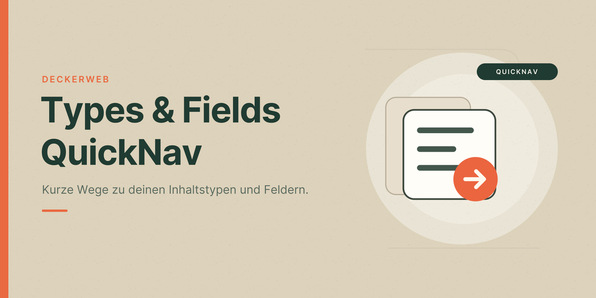

# Types & Fields QuickNav

[English](index.html)

Types & Fields QuickNav bringt die Verwaltung deiner Inhaltstypen und individuellen Felder in die WordPress-Toolbar. Feldgruppen, Inhaltstyp-Definitionen, Taxonomien und verfügbare Provider-Einstellungen sind damit an einem vertrauten Ort erreichbar.

Das Plugin gehört zur **QuickNav-Serie von deckerweb**: kleine, gezielte Werkzeuge, die den WordPress-Alltag erleichtern. Jedes QuickNav-Plugin verkürzt die Wege zu vorhandenen Funktionen und berücksichtigt dabei deren eigene Oberflächen und Berechtigungen.

Ob eigene Projekte oder wechselnde Kunden-Websites: Types & Fields QuickNav passt sich an die tatsächlich verfügbaren Provider an. Die Navigation lässt sich für jede Website konfigurieren – einschließlich der Frage, wer sie sehen darf.

## Featured Highlights

- **Ein Menü für deine Feld- und Inhaltstypen-Werkzeuge.** Feldgruppen, Inhaltstyp-Definitionen, Taxonomien und verfügbare Einstellungen direkt aus der WordPress-Toolbar erreichen.
- **Passt sich deiner Website an.** Erkennt aktive Provider und verfügbare Funktionen – auch bei mehreren kompatiblen Systemen auf derselben Website.
- **Für Kunden gezielt steuerbar.** Den gesamten QuickNav-Eintrag für ausgewählte Rollen oder einzelne Benutzer ausblenden.
- **Definitionen und Inhalte klar getrennt.** Die Verwaltungsnavigation bleibt übersichtlich. Inhaltslisten lassen sich bei Bedarf separat einschalten.
- **So viel Navigation, wie du brauchst.** Provider und einzelne Menüziele wählen; die Frontend-Toolbar optional hinzunehmen.

## Funktionen

- Navigation für ACF Free/Pro, Meta Box mit verfügbaren Erweiterungen, JetEngine, ACPT Free/Pro und Pods.
- Zusätzliche modulare Navigation für die Toolset-Suite und Unterstützung für Secure Custom Fields.
- Unabhängige Provider-Erkennung; mehrere kompatible Provider können gleichzeitig erscheinen.
- Optionale Links für ACF Extended, Better Search und Font Awesome Field; ACF Extended benötigt ACF Pro.
- Einzelne Schalter für Provider und Menüpunkte, klare Aktivitäts- und Verfügbarkeitsanzeigen.
- Rollen- und Benutzersperren für den gesamten Toolbar-Eintrag auf jeder Website.
- Getrennte Inhaltslisten und Frontend-Toolbar, beide standardmäßig ausgeschaltet.
- Einstellungen je Website, Multisite-Unterstützung und Berechtigungsprüfung für jedes Ziel.

[GitHub](https://github.com/deckerweb/types-fields-quicknav) · [Releases](https://github.com/deckerweb/types-fields-quicknav/releases) · [FAQ](FAQ-de.html) · [Docs / Doku](README-de.html)

GPL-2.0-or-later · Kostenlos · Von David Decker – DECKERWEB.
