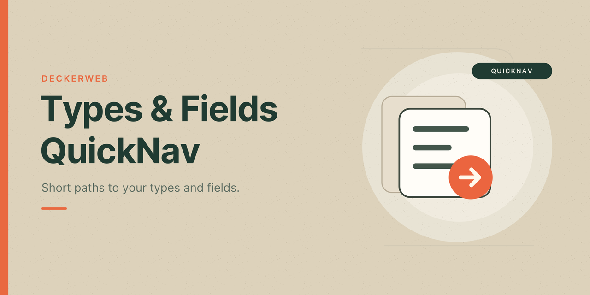

# Types & Fields QuickNav

[Deutsch](index-de.html)

Types & Fields QuickNav brings the administration of your content types and custom fields into the WordPress toolbar. Reach field groups, post type definitions, taxonomies and available provider settings from one familiar place.

It is part of the **deckerweb QuickNav series**: small, focused tools that make everyday WordPress administration easier. Each QuickNav plugin shortens the path to existing tools while respecting their own interfaces and permissions.

Whether you maintain your own projects or move between client websites, Types & Fields QuickNav adapts to the providers that are actually available. Configure the navigation for each website and decide who sees it.

## Featured Highlights

- **One menu for your types and fields tools.** Reach field groups, type definitions, taxonomies and available settings directly from the WordPress toolbar.
- **Adapts to your website.** Detects active providers and available features, including several compatible systems on one website.
- **Control visibility for client work.** Hide the entire QuickNav entry from selected roles or individual users.
- **Keep definitions and content separate.** Maintain clear administration navigation; enable a separate content-list branch when needed.
- **Choose the navigation you need.** Select providers and individual destinations; optionally include the frontend toolbar.

## Features

- Navigation for ACF Free/Pro, Meta Box with available extensions, JetEngine, ACPT Free/Pro and Pods.
- Additional modular Toolset suite navigation and Secure Custom Fields support.
- Independent provider detection; several compatible providers can appear together.
- Optional ACF Extended, Better Search and Font Awesome Field links; ACF Extended requires ACF Pro.
- Individual provider and destination switches, clear activity and availability badges.
- Role and individual user exclusions for the complete toolbar entry on each website.
- Separate content lists and frontend toolbar, both off by default.
- Site-scoped settings, multisite support and permission checks for each destination.

[GitHub](https://github.com/deckerweb/types-fields-quicknav) · [Releases](https://github.com/deckerweb/types-fields-quicknav/releases) · [FAQ](FAQ.html) · [Docs / Doku](README.html)

GPL-2.0-or-later · Free · By David Decker – DECKERWEB.
